# Лабораторная работа №6 - «Введение в FastAPI»

**Министерство науки и высшего образования Российской Федерации**  
**Кемеровский государственный университет, Институт цифры**

**Выполнил:** Филипишин Е.Е.
**Группа:** КБ-241  
**Проверил:** Жданов Н.В.  
**Год:** 2026

## Цель работы

Научиться создавать HTTP API с помощью FastAPI: работать с параметрами URL, принимать POST и PUT запросы, использовать Pydantic для проверки данных, разбивать приложение на модули, читать настройки из `.env`, обрабатывать ошибки и записывать действия в журнал. Изучить управление зависимостями через `uv` и историю изменений в Git.

## Установка и запуск (Windows)

1. Установить Python и менеджер [uv](https://docs.astral.sh/uv/getting-started/installation/). Пример установки через PowerShell: `winget install --id=astral-sh.uv -e`.
2. Распаковать архив `Filipishin_EE` 
3. В командной строке перейти в этот каталог.
4. Выполнить следующие команды:

```powershell
copy .env.example .env
uv venv
uv sync
uv run uvicorn main:app --reload
```

Для удобства те же действия выполняет `run_windows.bat` (в нём есть автоматическое создание `.env`). Сервер запускается на `http://127.0.0.1:8000`. Чтобы остановить сервер, нажать `Ctrl+C`.

**Открыть в браузере:**

- http://127.0.0.1:8000 - сообщение `Hello, FastAPI!`;
- http://127.0.0.1:8000/docs - интерактивная документация Swagger UI;
- http://127.0.0.1:8000/redoc - документация ReDoc.

**Проверка тестов:** `uv run pytest -q`. Во время проверки проекта локально выполнено 5 тестов, все завершились успешно. Для тестов используются `pytest` и `httpx`, указанные в группе `dev` файла `pyproject.toml`.

## Структура проекта

```text
Filipishin_EE/
├── .gitignore
├── .python-version
├── .env.example
├── main.py
├── demo_http.py
├── pyproject.toml
├── run_windows.bat
├── app/
│   ├── __init__.py
│   ├── config.py
│   ├── logging_setup.py
│   └── routers/
│       ├── __init__.py
│       └── items.py
├── tests/
│   └── test_api.py
├── screenshots/
│   ├── 01_docs.png
│   ├── 01_redoc.png
│   ├── 01_root.png
│   ├── 02_get_item.png
│   ├── 03_post_item.png
│   ├── 05_info.png
│   ├── 06_invalid_price.png
│   ├── 06_not_found.png
│   ├── 07_duplicate.png
│   ├── 07_get_updated.png
│   ├── 07_put_item.png
│   ├── 07_put_not_found.png
│   ├── 08_logging.png
│   └── 10_git_log.png
└── README.md
```

Данные товаров хранятся **в памяти программы** (`fake_db`), как предусмотрено заданием. После перезапуска сервера словарь снова содержит один тестовый товар `Foo` с ценой `50.2`.

## №1. Создание проекта и первый коммит

Инициализирован репозиторий Git. Созданы `.gitignore`, `pyproject.toml`, `.python-version`, виртуальное окружение и `main.py`. Для управления библиотеками используется `uv`. Начальный маршрут:

```python
@app.get("/")
def read_root():
    return {"message": "Hello, FastAPI!"}
```

Проверены корневой маршрут, `/docs` и `/redoc`. Каждый из трёх адресов вернул HTTP 200. Документация автоматически строится на основе описанных маршрутов.

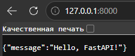

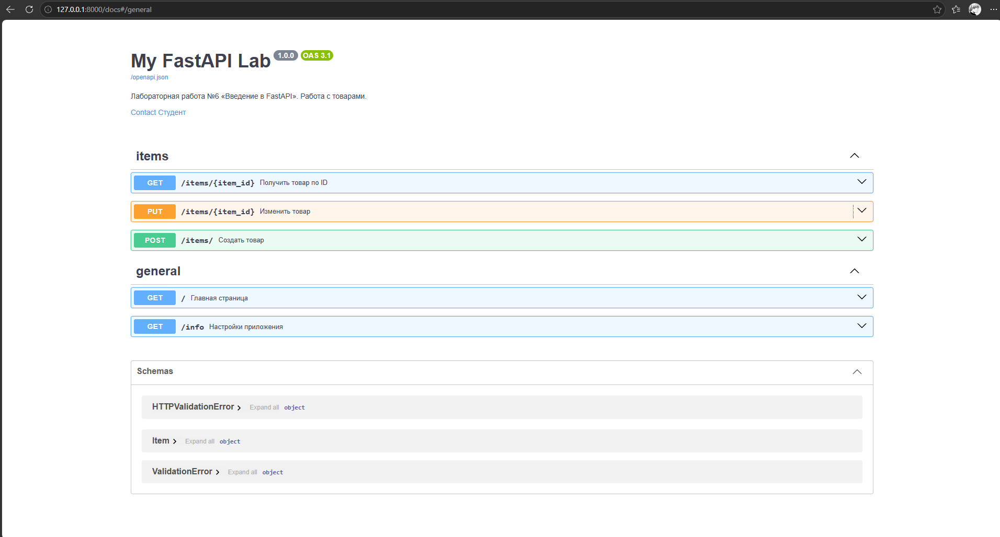

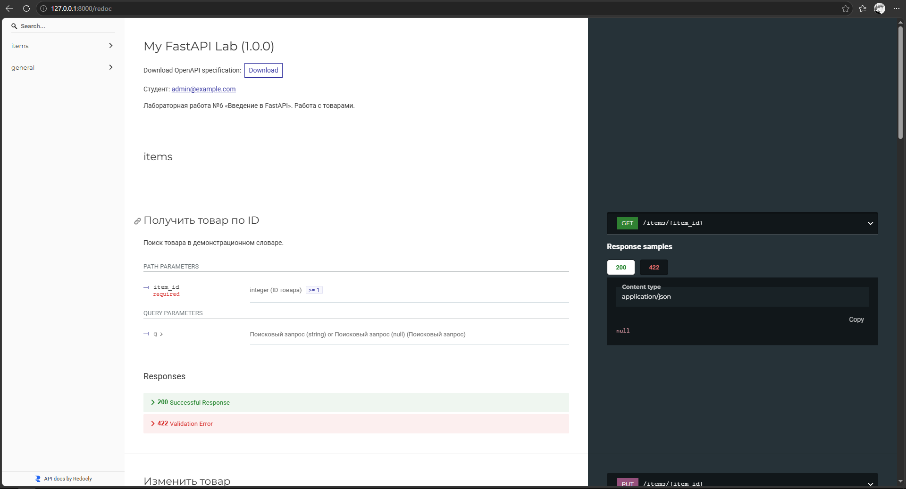

**Коммит:** `init: базовое FastAPI приложение с корневым маршрутом`.

## №2. Параметры пути и query

Добавлен GET `/items/{item_id}`. Обязательный `item_id` — целое число, а `q` — необязательная строка. Пример вызова:

```text
GET http://127.0.0.1:8000/items/1?q=test
```

В окончательной версии приложения этот запрос возвращает товар и параметр `q`:

```json
{"item_id":1,"item":{"name":"Foo","price":50.2,"is_offer":null},"q":"test"}
```

На этапе №2 до создания демонстрационной базы ответ был `{"item_id":1,"q":"test"}`. Он был изменён в задании №6 в соответствии с методичкой.

**Коммит:** `feat: добавлен эндпоинт /items/{item_id} с query параметром`.

**Результат выполнения задания №2:**

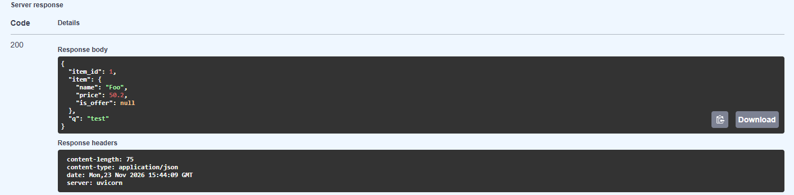

## №3. Модель Pydantic и POST-запрос

Создана модель `Item` с полями `name`, `price`, `is_offer`. Добавлен POST `/items/`, который принимает JSON-объект. Пример для `/docs` → **POST /items/** → **Try it out**:

```json
{"name":"Телефон","price":199.99,"is_offer":false}
```

Приложение возвращает созданный объект. С седьмого задания дополнительно сохраняет его в `fake_db` и проверяет уникальность названия.

**Коммит:** `feat: добавлена модель Item и POST /items/`.

**Результат выполнения задания №3:**

При отправке POST-запроса `/items/` с данными товара «Телефон» сервер успешно обработал запрос и вернул созданный объект в формате JSON. Код ответа — `200 OK`.

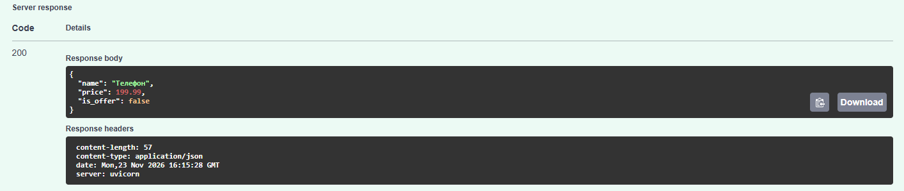

## №4. Вынос маршрутов в отдельный модуль

В папке `app/routers/` создан `items.py`, в котором находятся маршруты товаров. Они подключаются к FastAPI с помощью `app.include_router(items.router)`. Адреса запросов остались без изменений. `__init__.py` показывает, что папки являются пакетами Python.

**Коммит:** `refactor: вынос маршрутов товаров в отдельный роутер`.

## №5. Настройки через Pydantic Settings

Создан `app/config.py`, в котором объявлен класс `Settings`. Приложение читает конфигурацию из `.env`:

```dotenv
APP_NAME=My FastAPI Lab
ADMIN_EMAIL=admin@example.com
ITEMS_PER_PAGE=20
```

По адресу `GET /info` проверено, что `items_per_page` равно **20**, как указано в файле настроек.

**Результат выполнения задания №5:**

Проверена работа эндпоинта `GET /info`. Программа успешно считывает настройки из файла `.env` и возвращает значение `items_per_page = 20`. Код ответа сервера — `200 OK`.

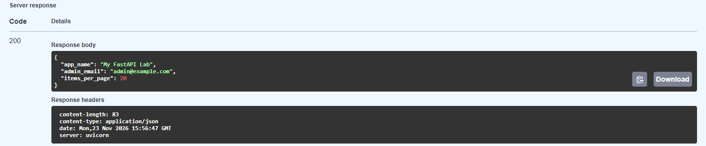

**Коммит:** `feat: добавлена конфигурация через Pydantic Settings`.

## №6. Обработка ошибок и документация

Для GET `/items/{item_id}` добавлена проверка существования ID. При отсутствии товара возвращается **HTTP 404** с ответом `{"detail":"Item not found"}`. Параметры описаны через `Path` и `Query`, а поля модели — через `Field` (названия, примеры, проверка положительной цены). В `/docs` доступны описание приложения, версия и контактная информация.

**Коммит:** `feat: обработка ошибок и расширение документации`.

**Результаты проверки обработки ошибок:**

При запросе несуществующего товара сервер возвращает ошибку 404.

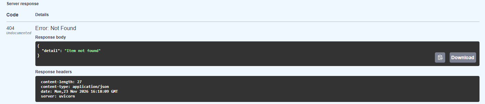

При попытке создать товар с отрицательной ценой сервер возвращает ошибку 422.

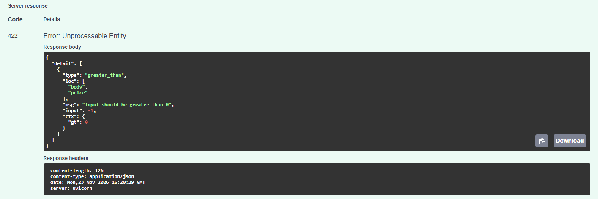

## №7. PUT и уникальность имени

Реализован `PUT /items/{item_id}` для обновления существующего товара. Добавлена проверка уникальности имени при POST и PUT: сравнение выполняется без учёта регистра букв и пробелов по краям. При попытке создать повторное имя программа возвращает **HTTP 409**; при обновлении отсутствующего товара — **HTTP 404**; отрицательная или нулевая цена — **HTTP 422**.

Пример PUT:

```json
{"name":"Ноутбук","price":650,"is_offer":true}
```

После изменения повторный GET `/items/2` возвращает обновлённый товар. Успешные и ошибочные результаты приведены ниже.

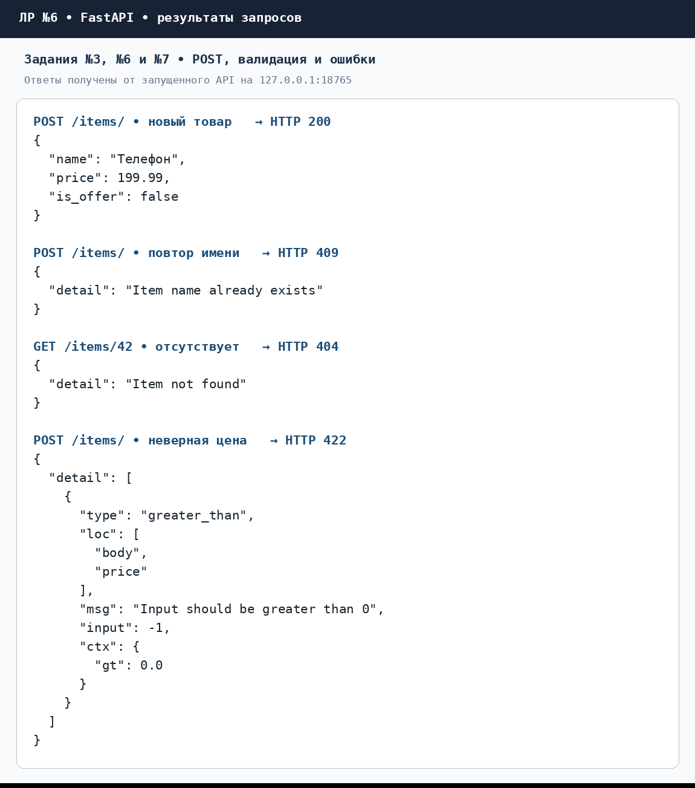

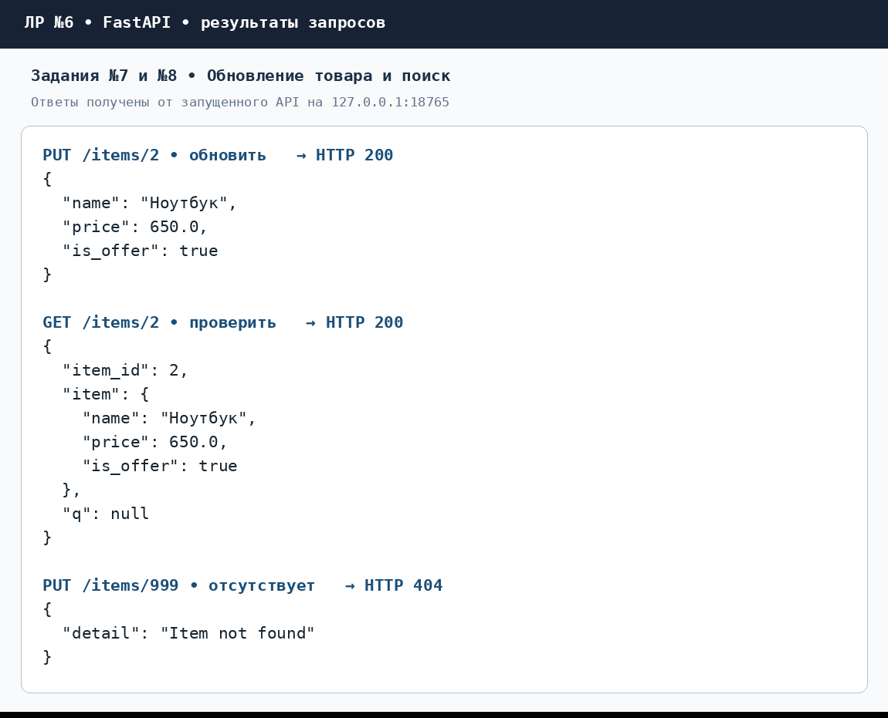

**Коммит:** `feat: обновление товара и проверка уникальности названий`.

**Проверка уникальности названия товара:**

При повторном добавлении товара с названием «Телефон» сервер возвращает ошибку 409.

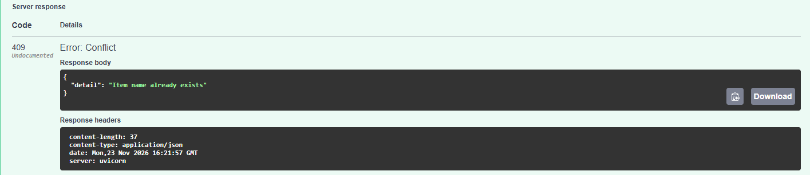

**Результаты выполнения задания №7:**

При выполнении PUT-запроса товар был успешно изменён. Сервер вернул код 200.

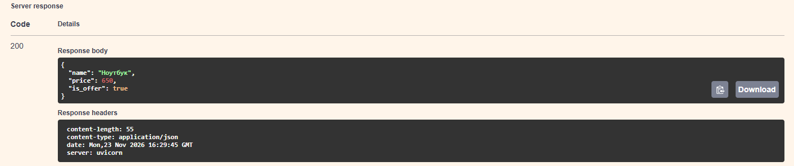

Повторный GET-запрос подтвердил сохранение изменений.

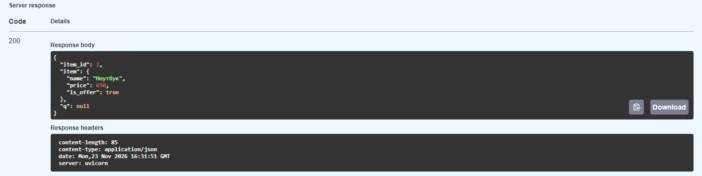

При попытке изменить несуществующий товар сервер вернул ошибку 404.

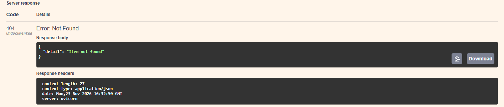

## №8. Журналирование

Использован стандартный модуль `logging`. Программа сохраняет метод, путь, код ответа и время обработки в `app.log`, а также выводит записи в консоль. Содержимое запросов, включая возможные пароли, в журнал не записывается.

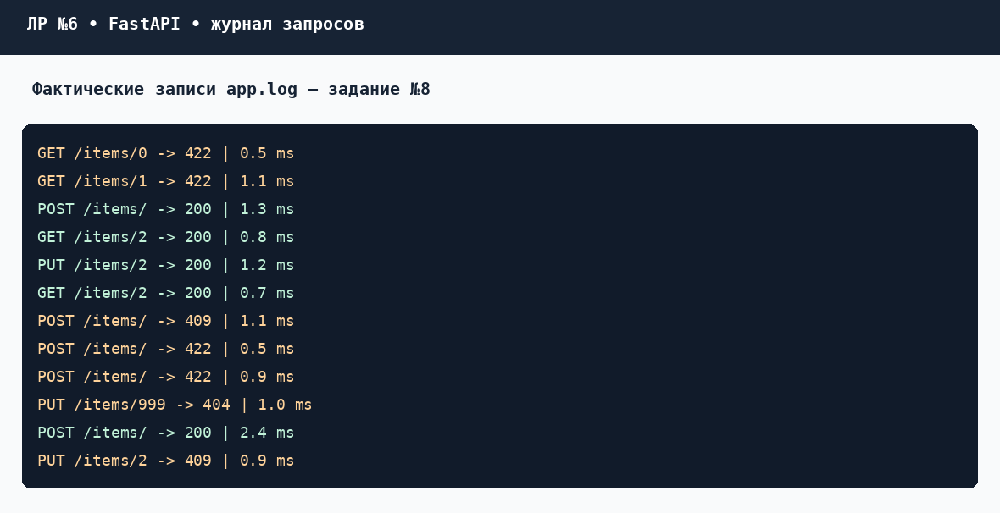

**Коммит:** `feat: добавлено логирование и тесты HTTP-запросов`.

**Результат выполнения задания №8:**

В приложении реализовано логирование HTTP-запросов. В файл `app.log` записываются метод запроса, адрес эндпоинта, код ответа сервера и время выполнения.

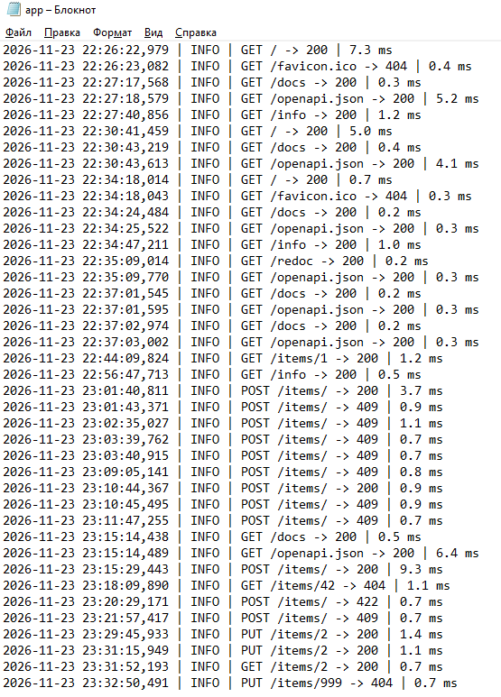

## №9. Подготовка отчёта

Создан `README.md` с описанием всех заданий, инструкцией запуска, проверками HTTP-запросов и изображениями реальных результатов работающего API. Демонстрационные изображения сформированы из **фактических HTTP-ответов локального тестового сервера** (на порту 18765); это оформленные снимки вывода запросов, а не снимки страницы браузера `/docs`. Для показа преподавателю интерфейса Swagger UI нужно открыть `/docs` в браузере своего компьютера.

**Коммит:** `docs: добавлен отчет с демонстрацией работы API`.

## №10. Завершение и публикация

История локальных изменений проверяется командой:

```bash
git log --oneline
```

Каждый пункт лабораторной работы отражён в отдельном коммите. Последние шаги: сформировать `uv.lock`, указать своё имя в Git, создать публичный репозиторий и выполнить `git push`.

**Результат выполнения задания №10:**

С помощью команды `git log --oneline` была проверена история изменений проекта. В репозитории отображаются 10 последовательных коммитов, соответствующих этапам выполнения лабораторной работы.

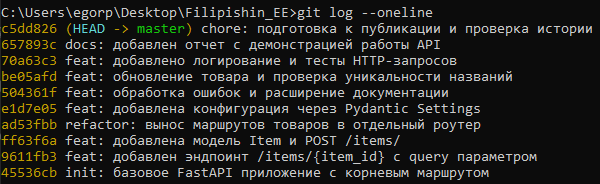

**Публикация проекта**

Проект опубликован в публичном репозитории GitHub. История изменений содержит последовательные коммиты по этапам выполнения лабораторной работы.

**Ссылка на репозиторий:** https://github.com/exxxxer/lab6

## Проверка работы приложения

При запуске сервера и выполнении тестовых запросов получены результаты (подробный журнал последовательных проверок этапов №1–8 — `stage_checks.txt`):

| Проверка | Результат |
|---|---|
| `GET /` | HTTP 200, `Hello, FastAPI!` |
| `GET /docs` и `GET /redoc` | HTTP 200 |
| `GET /items/1?q=test` | HTTP 200, товар `Foo` и `q=test` |
| `GET /info` | HTTP 200, `items_per_page=20` |
| `POST /items/` (новый товар) | HTTP 200, данные товара |
| `POST /items/` (повторное название) | HTTP 409 |
| `POST /items/` (отрицательная цена) | HTTP 422 |
| `GET /items/42` | HTTP 404 |
| `PUT /items/2` | HTTP 200, обновление выполнено |
| `PUT /items/999` | HTTP 404 |
| Автоматические тесты | `5 passed` |

## Вывод

В ходе лабораторной работы было создано приложение FastAPI для работы с товарами. Освоены GET, POST и PUT запросы, валидация с Pydantic, обработка ошибок, конфигурация через `.env`, разделение кода по роутерам, журналирование и тестирование. Проект подготовлен к публикации на GitHub после настройки учётной записи и генерации `uv.lock` на компьютере с доступом к PyPI.

## Использованные источники

1. [FastAPI: документация](https://fastapi.tiangolo.com/)
2. [uv: управление зависимостями](https://docs.astral.sh/uv/)
3. [Pydantic: документация](https://docs.pydantic.dev/)
4. [Git: документация](https://git-scm.com/doc)
5. Методические указания к лабораторной работе №6 «Введение в FastAPI».